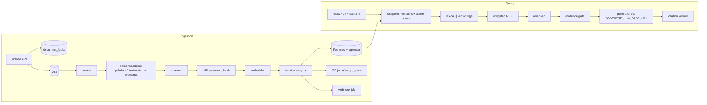

# Footnote

A RAG engine that runs on Postgres alone: hybrid search, reranking and cited answers, with no vector database and no extra services.

**Status:** v0.1.0, the first release. Before 1.0, a minor release may change the HTTP API,
the configuration or the schema; every change is listed in the [changelog](CHANGELOG.md).

[](https://github.com/thnhdatle/footnote/actions/workflows/ci.yml)
[](https://github.com/thnhdatle/footnote/releases)
[](LICENSE)

## Why it exists

Teams that want answers grounded in their own documents usually end up running a vector
database, a search engine, a queue and a model server next to the database they already
operate. Footnote keeps documents, vectors, full-text indexes, jobs and tenants in
Postgres with pgvector, so one backup and one set of credentials cover everything. Every
answer cites the passages it used, and when the evidence is too weak the engine abstains
instead of guessing. The language model is any OpenAI-compatible endpoint you choose; the
embedder and reranker are small pinned models that run on the CPU.

## Quickstart

Both ways of trying it need Docker with Compose v2 and about 10 GB of VM memory. The stack is
[`deploy/docker-compose.yml`](deploy/docker-compose.yml). The full walkthrough is in
[`docs/guides/getting-started.md`](docs/guides/getting-started.md).

### With a real LLM (not run in CI)

Point Footnote at any OpenAI-compatible chat endpoint: LM Studio, Ollama or OpenAI.

```sh
make docker                                   # build thnhdatle/footnote:dev
export FOOTNOTE_LLM_BASE_URL=http://host.docker.internal:1234/v1   # LM Studio; Ollama usually http://host.docker.internal:11434/v1
export FOOTNOTE_LLM_MODEL=<model name your endpoint serves>
export FOOTNOTE_LLM_API_KEY=<key, if the endpoint needs one>
make up                                       # Postgres + Footnote, waits until healthy
```

Then create a tenant, upload a PDF and ask a question as in
[`getting-started.md`](docs/guides/getting-started.md) (sections 3 to 5).

### Offline smoke test with fakellm

This is an offline smoke test, not a quality check. `fakellm` is a deterministic stub: it
returns a canned answer, so you can verify that the whole pipeline (upload, parse, embed,
search, answer, citation check) works without any model server. Footnote is configured with
`llm.base_url` set to the compose `fakellm` service and one extra header that scripts the reply:

```yaml
llm:
  base_url: http://fakellm:8090/v1
  extra_headers: {"X-Fake-Answer": "Offline smoke test (canned answer) citing [1]."}
```

```sh
make docker                      # build the image (not timed)
examples/quickstart/run.sh       # start the stack, upload a sample PDF, ask, check the citation
make down                        # stop and remove the stack and its volumes
```

The commands and sample files are in [`examples/quickstart/`](examples/quickstart/README.md);
CI runs it with `make quickstart-test`. It needs `curl` and `jq`. The first run
downloads the pinned models from `huggingface.co`.

## Install

Footnote v0.1 ships as a multi-architecture container image (`linux/amd64`, `linux/arm64`);
there is no Python package on PyPI.

```sh
docker pull ghcr.io/thnhdatle/footnote:v0.1.0
```

- **Compose**: from a clone, `RAYLD_FOOTNOTE_IMAGE=ghcr.io/thnhdatle/footnote:v0.1.0 make up`
  runs Postgres with pgvector and Footnote from
  [`deploy/docker-compose.yml`](deploy/docker-compose.yml) using the released image.
- **Kubernetes**: the manifests in [`deploy/kubernetes/`](deploy/kubernetes/) use the same
  image; see [operations](docs/guides/operations.md) for migrations, model download, roles
  and upgrades.

The image needs PostgreSQL 15 or later with pgvector 0.8.0 or later, and downloads the pinned models once
with `footnote models pull`.

## Architecture



Uploads become jobs in Postgres. A worker parses each file in a sandboxed child process,
splits it into chunks, embeds only the chunks whose content hash changed, and swaps in the
new document version in one transaction. A query reads one snapshot, runs a full-text leg
and a vector leg in parallel, fuses them with weighted reciprocal rank fusion and reranks the
top candidates with a cross-encoder. An evidence gate then decides whether to answer or
abstain, the generator writes the answer through your OpenAI-compatible endpoint, and a
citation verifier checks every marker against the retrieved text. The guides in
[`docs/guides/`](docs/guides/) describe each stage and its parameters.

## Features

- **Ingestion**: PDF, DOCX, HTML, Markdown and TXT, sandboxed parsing, versions and
  incremental re-indexing by content hash. Guide: [ingestion.md](docs/guides/ingestion.md).
- **Retrieval**: lexical and vector search, weighted RRF fusion, int8 or fp32 cross-encoder
  reranking. Guide: [retrieval.md](docs/guides/retrieval.md).
- **Answers and citations**: cited answers, verified markers and quote spans, abstention when
  evidence is weak. Guide: [citations.md](docs/guides/citations.md).
- **Multi-tenancy**: tenants, API keys and key rotation. Guide:
  [multi-tenancy.md](docs/guides/multi-tenancy.md).
- **HTTP API and webhooks**: Guides: [api.md](docs/guides/api.md),
  [webhooks.md](docs/guides/webhooks.md), [errors.md](docs/guides/errors.md).
- **Evaluation**: reproducible retrieval evaluation and calibration on public datasets.
  Guide: [evaluation.md](docs/guides/evaluation.md).
- **Operations**: roles, poolers, backups, upgrades, metrics. Guides:
  [operations.md](docs/guides/operations.md),
  [troubleshooting.md](docs/guides/troubleshooting.md).

### Models & data

Full details: [`docs/guides/models-and-data.md`](docs/guides/models-and-data.md). This is
not legal advice; check that the terms fit your use.

| Model | Role | License | Training data |
|---|---|---|---|
| `BAAI/bge-small-en-v1.5` | embedder, 384 dimensions | MIT | pre-training and contrastive fine-tuning; the model card lists no per-dataset training data |
| `cross-encoder/ms-marco-MiniLM-L6-v2` | reranker, 22.7M parameters | Apache-2.0 | MS MARCO passage ranking |

- Models are pinned by revision and SHA-256 in [`models/manifest.yaml`](models/manifest.yaml)
  and downloaded by `footnote models pull`; weights are never committed or shipped in the
  image. Dependency license exceptions are reviewed in [`licenses/`](licenses/exceptions.yaml).
- **Training-data caveat**: both licenses allow commercial use, but the reranker was
  trained on MS MARCO, whose terms are non-commercial. Whether that fits your use is your
  assessment. If it does not, set `rerank.provider: noop` or use a reranker you have cleared.
  Footnote does not train or fine-tune any model.
- **Datasets** are downloaded on demand and never committed to the repository or shipped in
  the image:

  | Dataset | Used for | License and terms |
  |---|---|---|
  | BEIR SciFact claims | retrieval, answers, abstention | CC BY 4.0 |
  | BEIR SciFact abstracts (corpus) | the same | ODC-By 1.0 |
  | BEIR TREC-COVID (CORD-19 papers) | latency at 100k chunks | mixed per-paper licenses; benchmark use only, not redistributed |

- **Attribution**: credit the SciFact authors (Wadden et al.), the BEIR benchmark (Thakur
  et al.) and, for TREC-COVID, the CORD-19 and TREC-COVID organisers if you publish results.
  Do not republish CORD-19 text.
- **Parser fidelity** is measured on generated fixtures (documents produced by the test
  suite), not on third-party corpora; real-world documents may parse differently.

## Benchmarks

Footnote v0.1.0 pre-release build on a MacBook Pro M3 Pro 36 GB, macOS 26.1, Docker VM
8 CPU / 10 GB, Python 3.12.13. Full tables, minima, maxima and thresholds:
[`bench/RESULTS.md`](bench/RESULTS.md); how the numbers are produced:
[`acceptance/README.md`](acceptance/README.md).

| Benchmark | Metric | Result | Acceptance threshold |
|---|---|---|---|
| SciFact retrieval, 300 queries | vector nDCG@10 | 0.7221 | >= 0.69 |
| | lexical nDCG@10 | 0.5900 | >= 0.38 |
| | hybrid nDCG@10 | 0.7224 | reported |
| | hybrid+rerank nDCG@10 | 0.7093 | >= 0.65 |
| | hybrid+rerank recall@10 | 0.8429 | >= 0.75 |
| Abstention gate, 100 answerable + 100 unanswerable SciFact claims | AUC | 0.6258 | >= 0.62 |
| | answer rate (answerable claims) | 0.80 | >= 0.75 |
| | abstain rate (unanswerable claims) | 0.28 | >= 0.25 |
| Hybrid+rerank latency, 100,000 chunks | p50 ms | 330.2 | reported |
| | p95 ms | 368.2 | < 600 |
| | p99 ms | 393.6 | reported |

The abstention gate passes its thresholds by small margins: AUC by 0.0058 (with 100 claims
per group the AUC has a standard error of about 0.04, an approximate 95% interval of 0.55
to 0.70), the answer rate by 0.05 and the abstain rate by 0.03. On near-topic questions,
SciFact claims whose supporting abstracts were removed from a corpus that still holds
related abstracts, the gate abstains on only 28%. On 200 clearly off-topic questions
([`eval/sets/unanswerable.jsonl`](eval/sets/unanswerable.jsonl)) it abstains on all of them
(AUC 0.996). The gate score, threshold resolution and calibration are described in
[citations.md](docs/guides/citations.md) and [evaluation.md](docs/guides/evaluation.md).

### Ablation

From [`eval/ablation.md`](eval/ablation.md) (SciFact test split, 300 queries, run
`20261020T091940Z` on the same build; rows marked shipped are the defaults). Document-level
metrics; p50 and p95 are in-process search latency per query. Latency varies by a few
percent between runs, so the SciFact rows here all come from this
one run.

| Configuration | Split | R@1 | R@5 | R@10 | R@100 | nDCG@10 | MRR@10 | p50 ms | p95 ms | Queries |
|---|---|---|---|---|---|---|---|---|---|---|
| vector **shipped** | test | 0.5854 | 0.7661 | 0.8469 | 0.9567 | 0.7221 | 0.6870 | 20.1 | 24.8 | 300 |
| lexical any+ts_rank **shipped** | test | 0.4500 | 0.6514 | 0.7205 | 0.8556 | 0.5900 | 0.5587 | 33.9 | 44.8 | 300 |
| lexical any+ts_rank_cd | test | 0.2228 | 0.4356 | 0.5250 | 0.7690 | 0.3717 | 0.3290 | 44.5 | 74.5 | 300 |
| lexical all+ts_rank | test | 0.0661 | 0.0661 | 0.0661 | 0.0661 | 0.0669 | 0.0700 | 13.0 | 15.0 | 300 |
| lexical websearch+ts_rank | test | 0.0694 | 0.0694 | 0.0694 | 0.0694 | 0.0703 | 0.0733 | 13.3 | 15.9 | 300 |
| hybrid lexical weight 1 | test | 0.5619 | 0.7432 | 0.8132 | 0.9467 | 0.6954 | 0.6651 | 44.7 | 57.3 | 300 |
| hybrid lexical weight 0.5 | test | 0.5886 | 0.7638 | 0.8362 | 0.9683 | 0.7172 | 0.6858 | 44.9 | 56.9 | 300 |
| hybrid lexical weight 0.3 | test | 0.5794 | 0.7788 | 0.8496 | 0.9567 | 0.7205 | 0.6850 | 44.2 | 57.3 | 300 |
| hybrid lexical weight 0.2 **shipped** | test | 0.5827 | 0.7721 | 0.8496 | 0.9567 | 0.7224 | 0.6875 | 44.4 | 57.6 | 300 |
| hybrid+rerank int8 rerank_n 30 **shipped** | test | 0.5679 | 0.7693 | 0.8429 | 0.9567 | 0.7093 | 0.6725 | 281.1 | 304.0 | 300 |
| hybrid+rerank int8 rerank_n 50 | test | 0.5596 | 0.7610 | 0.8177 | 0.9567 | 0.6959 | 0.6641 | 422.4 | 450.5 | 300 |
| hybrid+rerank fp32 rerank_n 30 | test | 0.5646 | 0.7649 | 0.8329 | 0.9567 | 0.7045 | 0.6692 | 509.8 | 547.4 | 300 |
| hybrid+rerank fp32 rerank_n 50 | test | 0.5629 | 0.7588 | 0.8152 | 0.9567 | 0.6968 | 0.6655 | 856.4 | 1099.4 | 300 |
| hybrid+rerank int8 rerank_n 30, recursive chunking | test | 0.5679 | 0.7693 | 0.8429 | 0.9567 | 0.7093 | 0.6725 | 288.5 | 331.9 | 300 |
| bm25s (reference, in-process) | test | 0.5342 | 0.7362 | 0.8187 | 0.9127 | 0.6863 | 0.6492 | 0.2 | 0.2 | 300 |

The lexical weight (0.2) was chosen on the train split (809 queries), where it had the best
nDCG@10 of the four weights tried (0.7503). Published BEIR references on SciFact, nDCG@10:
BM25 0.665, BM25+CE 0.688.

### Trade-offs

Reranking costs latency and, on SciFact, does not raise nDCG@10 over hybrid search alone
(0.7093 against 0.7224). It is on by default because it also feeds the evidence gate that
decides when to abstain. Its cost grows with the number of candidates and with precision:

| Setting | nDCG@10 | R@10 | p95 ms |
|---|---|---|---|
| hybrid, no rerank | 0.7224 | 0.8496 | 57.6 |
| hybrid+rerank int8, rerank_n 30 (shipped) | 0.7093 | 0.8429 | 304.0 |
| hybrid+rerank int8, rerank_n 50 | 0.6959 | 0.8177 | 450.5 |
| hybrid+rerank fp32, rerank_n 30 | 0.7045 | 0.8329 | 547.4 |
| hybrid+rerank fp32, rerank_n 50 | 0.6968 | 0.8152 | 1099.4 |

Source: [`eval/ablation.md`](eval/ablation.md). The reference `bm25s` row is an in-process
library, not a Postgres implementation; the Postgres lexical leg scores 0.5900 against its
0.6863 nDCG@10.

## Configuration

One YAML file plus environment variables; every option has a `FOOTNOTE_<PATH>` variable and
secrets are never read from the file. Reference:
[`docs/guides/configuration.md`](docs/guides/configuration.md); annotated example:
[`deploy/config.example.yaml`](deploy/config.example.yaml).

| Option | Default | Environment variable | What it does |
|---|---|---|---|
| `llm.base_url` | `""` (answers disabled) | `FOOTNOTE_LLM_BASE_URL` | OpenAI-compatible chat endpoint |
| `llm.model` | `""` | `FOOTNOTE_LLM_MODEL` | chat model name sent to the provider; required when `llm.base_url` is set |
| `retrieval.k` | `8` | `FOOTNOTE_RETRIEVAL_K` | results returned |
| `rerank.variant` | `int8` | `FOOTNOTE_RERANK_VARIANT` | `int8` or `fp32` reranker |
| `database.pool_max` | `20` | `FOOTNOTE_DATABASE_POOL_MAX` | maximum pooled connections |

## Known limitations

- **Abstention is weak on near-topic questions.** The evidence gate abstains on only 28% of
  SciFact claims whose evidence was removed, while answering 80% of answerable ones (AUC
  0.6258, just above the 0.62 threshold; see Benchmarks). It reliably abstains on off-topic
  questions. Raise `answer.evidence_threshold_rerank` to trade answers for fewer unsupported
  ones, and measure on your own questions ([evaluation guide](docs/guides/evaluation.md)).
- **Measured on Apple Silicon only.** Benchmarks and gate calibration ran on an M3 Pro
  (arm64). The `linux/amd64` image uses the AVX2 int8 reranker file; its gate threshold was
  computed through ONNX Runtime on arm64 and has not been checked on amd64 hardware.
- **Answer quality is judged by the generating model.** The faithfulness and citation
  precision check uses the same local model to generate and to judge, which inflates both
  scores; it answered 58 of 100 SciFact questions and abstained on 42.
- **`make up` always starts the `fakellm` stub** next to Footnote, so it pulls
  `ghcr.io/thnhdatle/fakellm:v0.1.0` even when you point Footnote at a real LLM.
- **No OCR and English-centric search.** Scanned documents are not supported, and full-text
  search uses the `simple` or `english` configurations only.
- **Image only.** v0.1 is not published on PyPI.

## Comparison and when not to use it

- **Pick Footnote** when you already run Postgres, want one system to back up, and need
  cited answers with abstention. It is a service with an HTTP API, not a framework.
- **Not for very large corpora or high query rates.** The published latency is for 100000
  chunks on one laptop-class machine (p95 368.2 ms); it has not been measured beyond that.
- **Not for scanned documents.** There is no OCR. Supported types are PDF, DOCX, HTML,
  Markdown and TXT.
- **Reranking is not always better.** On SciFact the reranker lowers nDCG@10 slightly
  (see Trade-offs); measure on your own data with the evaluation guide before relying on it.
- **A dedicated search engine or vector database** may suit you better if you need features
  Footnote does not have: connectors, a chat UI, GraphRAG, query rewriting, or non-English
  full-text languages beyond `simple` and `english` (see the roadmap).

## Roadmap

Deferred scope and non-goals for v0.1 are in [`ROADMAP.md`](ROADMAP.md).

## Contributing

See [`CONTRIBUTING.md`](CONTRIBUTING.md). Please report vulnerabilities as described in
[`SECURITY.md`](SECURITY.md) and follow the [Code of Conduct](CODE_OF_CONDUCT.md).

## License

Apache-2.0. See [`LICENSE`](LICENSE) and [`NOTICE`](NOTICE).
