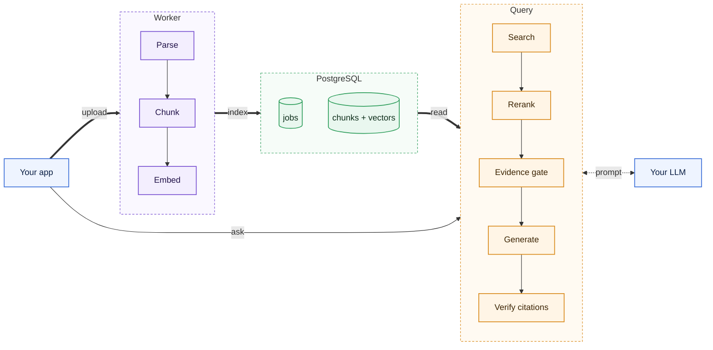

# Footnote

A RAG engine that runs on Postgres alone and answers questions with citations.

[](https://github.com/thnhdatle/footnote/actions/workflows/ci.yml)
[](https://github.com/thnhdatle/footnote/releases)
[](LICENSE)

## Architecture



Uploads become jobs in Postgres, and a worker parses, chunks and embeds each file before it
swaps in the new version in one transaction. A query runs full-text and vector search, reranks
the results with a cross-encoder, and answers through your LLM only when the evidence is
strong enough.

## Why

Grounded answers usually mean running a vector database, a search engine and a queue next to
the database you already have. Footnote keeps documents, vectors, indexes, jobs and tenants in
Postgres with pgvector, so one backup and one set of credentials cover everything. Every
answer cites its passages, and when the evidence is weak it abstains instead of guessing,
while the language model is any OpenAI-compatible endpoint you choose.

## Install

```sh
docker pull ghcr.io/thnhdatle/footnote:v0.1.0    # server and worker, linux/amd64 and linux/arm64
```

There is no package on PyPI. The image needs PostgreSQL 15 or later with pgvector 0.8.0 or
later. It downloads its small pinned embedding and reranking models once, and runs them on the
CPU. The reranker was trained on MS MARCO, whose terms are non-commercial; check that this fits
your use. Compose and Kubernetes manifests are in [deploy](deploy).

## Quickstart

Needs Docker with Compose v2, about 10 GB of VM memory, `curl` and `jq`. From a clone:

```sh
make docker                      # build the image (not timed)
examples/quickstart/run.sh       # start the stack, upload a sample PDF, ask, check the citation
make down                        # stop and remove the stack and its volumes
```

It prints a canned answer from a stub LLM with one verified citation. This checks the
pipeline, not answer quality. The first run downloads the models from Hugging Face.

## Usage

```sh
curl -X POST $FOOTNOTE_URL/v1/collections/$COLLECTION/documents \
  -H "Authorization: Bearer $KEY" -F file=@handbook.pdf

curl -X POST $FOOTNOTE_URL/v1/collections/$COLLECTION/answers \
  -H "Authorization: Bearer $KEY" -H "Content-Type: application/json" \
  -d '{"question": "How many vacation days do I get?"}'
```

The upload returns a job that a worker processes. The answer carries `answer`, `citations`
and `abstained`. Tenants, keys, real LLMs, webhooks and operations are covered in the
[guides](docs/guides).

## Performance

MacBook Pro M3 Pro 36 GB, Docker VM 8 CPU / 10 GB, Footnote v0.1.0. Retrieval on the 300 SciFact
test claims; latency over 1,000 queries against 100,000 chunks, median of 3 runs.

| Scenario | Result |
|---|---|
| SciFact retrieval, hybrid+rerank nDCG@10 | 0.7093 |
| SciFact retrieval, hybrid+rerank recall@10 | 0.8429 |
| Hybrid+rerank latency p95, 100,000 chunks | 368.2 ms |

## Documentation

- [Guides](docs/guides)
- [Roadmap](ROADMAP.md)
- [Changelog](CHANGELOG.md)
- [Contributing](CONTRIBUTING.md)
- [Security](SECURITY.md)
- [License: Apache-2.0](LICENSE)
